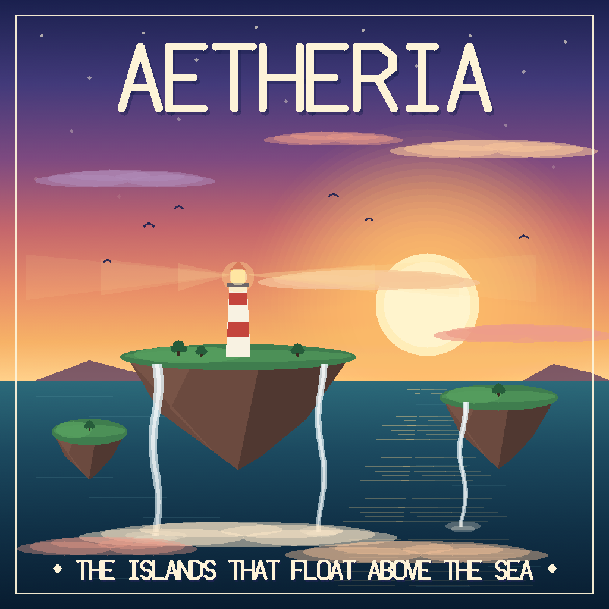

# AETHERIA — The Poster for a Place That Isn't There

[](https://make.fun/bounty/the-poster-for-a-place-that-i-2-20261121-0539)
[](https://make.fun/bounty/the-poster-for-a-place-that-i-2-20261121-0539)
[](https://make.fun/bounty/the-poster-for-a-place-that-i-2-20261121-0539)

An entry for [The Poster for a Place That Isn't There](https://make.fun/bounty/the-poster-for-a-place-that-i-2-20261121-0539) on [make.fun](https://make.fun) (referral: `6etrfz79`).

## The place

**AETHERIA — the islands that float above the sea.** A chain of green-topped
isles drifts in a golden sunset sky, waterfalls pouring off their edges into
the clouds below. On the largest isle stands a white lighthouse with red
bands, its beam sweeping toward the low sun — the landmark every skyferry
steers by. Visitors sleep above the clouds and wake to a sea of light.

## The poster

`main.py` draws the poster entirely in code — pure Python standard library,
no network, no third-party packages — so it renders byte-identical on every
run, including in the grading sandbox. It paints a dusk gradient sky, a low
sun with a soft glow, a glittering sun-path on the sea, three floating
islands with waterfalls, and the lighthouse, then sets the place name
**AETHERIA** in large hand-built geometric capitals across the sky, with the
tagline *THE ISLANDS THAT FLOAT ABOVE THE SEA* low over the water.



## Run it

```sh
python3 main.py
# writes /output/entry.png (1024 x 1024, well under 1 MiB)
```

Deterministic: running it twice produces identical bytes.

## License

MIT — see [LICENSE](LICENSE).
